# 넷플릭스 비영어권 TV: 기본 수요, 작품 수명, 감쇄 패턴 분석 (2021~2026)

코디세이 AI 네이티브 · 미션 「AI 데이터 분석: 데이터 기반 트렌드 분석」

## 1. 분석 주제 및 선정 이유

**주제**: 넷플릭스 주간 글로벌 Top 10 비영어권 TV 시리즈의 시청 시간을 시계열로 분석해, 플랫폼의 기본 수요, 작품의 수명, 최고점 이후의 감쇄 패턴을 살펴본다.

**선정 이유**
- 넷플릭스에서 영어권 시청자에게 인기 있는 콘텐츠와 비영어권에서 인기 있는 콘텐츠가 서로 다르다고 느껴서, 비영어권 쪽만 따로 떼어 어떤 흐름을 보이는지 살펴보고 싶었다.
- 평소 관심 있는 분야이기도 했고, 새 작품이 나오면 시청 시간이 갑자기 오르내리는데 이것이 플랫폼 전체의 흐름인지 소수 작품의 효과인지 궁금했다.
- 주 단위 시청 시간은 작품이 얼마나 오래 시청되는지를 보여 주므로, 작품의 수명과 감쇄를 시계열로 살펴보기에 적합하다고 판단했다.

## 2. 분석 질문

| # | 질문 | 사용한 시계열 기법 | 관련 그림 |
|---|---|---|---|
| Q1 | 비영어권 TV의 주간 시청 시간의 기본 수요는 5년간 성장했는가, 유지됐는가? | 후행 이동평균(4주, 12주), 연도별 평균·중앙값 비교 | 그림 1, 5 |
| Q2 | 주간 시청 시간의 큰 변동은 시장 전체의 흐름인가, 특정 작품의 충격인가? | 전주 대비 증감률(WoW), STL 분해의 잔차 | 그림 2, 7 |
| Q3 | 작품이 Top 10에 머문 기간은 어떻게 분포하고, 누가 시청 시간을 가져가는가? | 수명 그룹 분류, 분포 비교 | 그림 3 |
| Q4 | 최고점 이후 시청 시간은 작품별로 어떻게 줄어드는가? | 최고점 대비 정규화 감쇄 곡선 (3개 사례) | 그림 4 |
| Q5 | 상위 작품은 어떤 언어권에 몰려 있으며, 시간에 따라 달라졌는가? | 직접 분류와 연도별 구성 비교 | 그림 6 |

## 3. 데이터 설명

| 항목 | 내용 |
|---|---|
| 출처 | Netflix Top 10 웹사이트(netflix.com/tudum/top10) → Downloads → Lists → Global Lists, 파일 `all-weeks-global.tsv` |
| 내려받은 시점 | 2026-09-30 이후 (데이터 마지막 주가 2026-09-27이므로 그 뒤에 받음. 정확한 날짜 기록은 없음). 원본은 `data/raw/all-weeks-global.tsv`에 저장 |
| 대상 | 카테고리 `TV (Non-English)` |
| 기간 | 2021-07-04 ~ 2026-09-27, 274주 |
| 규모 | 고유 작품명 666편(시즌 단위로는 802개 시즌), 원본 10,960행(274주 × 4개 부문 × 순위 10), 이 중 비영어권 TV 2,740행 |
| 값의 의미 | `weekly_hours_viewed`: 해당 주에 Top 10에 든 작품의 전 세계 시청 시간(시간). 누적값이 아님 |
| 범위의 한계 | **Top 10에 든 작품만** 포함. 순위 밖 작품과 Top 10 밖의 시청은 알 수 없음 |

### 정제와 점검 결과
- **결측·중복·주 누락**: 274주 사이 간격이 모두 7일이었고, 결측과 중복, 0 이하 값은 없었다. 그래서 행을 삭제하거나 값을 채운 것은 없다.
- **Top 10 밖의 주는 0이 아니라 값 없음(NaN)으로 둔다.** 순위 밖이라고 시청이 0이었던 것은 아니기 때문이다. 감쇄 곡선(그림 4)에서는 이 구간을 선으로 잇지 않고 끊어서 보여 준다.
- **이상치**: 주간 합계에 사분위 범위 기준(Q3 + 1.5×IQR)을 적용하면 274주 중 22주가 상한선을 넘었다. 이 22주는 8개 작품에서 나왔고, 그중 오징어 게임이 10주였다. **삭제하지 않았다.** 오류가 아니라 실제로 일어난 대형 신작 효과이고, 이 분석이 바로 그 효과를 다루기 때문이다. 대신 평균 대신 중앙값을 함께 보고, 그래프에서는 상한을 넘는 값을 실제 값으로 표시해 오해를 줄였다.
- **작품·시즌 분리**: 같은 작품의 여러 시즌이 한 주에 함께 순위에 들면 행이 겹친다. 감쇄 분석은 `show_title`과 `season_title`을 함께 써서 최고점이 속한 시즌만 사용했다.
- **첫 주의 부분 주**: 작품이 주 중에 공개되면 첫 주는 며칠치 시청만 포함한다. 오징어 게임 시즌 1의 첫 주가 최고점의 11%에 그친 것이 그 예이며, 최고점은 공개 2주 뒤였다.

### 집계 단위를 이렇게 정한 이유
- **주간 합계(Top 10 전체)**: 시계열 기법(이동평균, WoW, STL)은 일정한 간격의 한 줄짜리 시계열이 필요하므로 주마다 Top 10의 시청 시간을 합했다. 단점은 합계가 대형 신작 한 편에 크게 좌우된다는 점이다.
- **작품 단위(수명 분석)**: 수명, 누적, 최고 주간 시청은 작품마다 한 줄로 요약해야 비교할 수 있어서 작품 단위로 집계했다. 제목(666편)과 시즌(802개) 중 수명 분류는 제목 단위를 썼다.
- **연도 단위(그림 5)**: 한 해의 수준을 보려는 것이라 달력 연도로 나눴다. 이 방식은 연말·연초에 걸친 히트가 두 해로 쪼개진다는 한계가 있다(인사이트 1의 반례 참고).

정리하면 수명 분포와 누적 시청 비교는 제목(`show_title`) 기준, 최고점 이후 감쇄 분석은 시즌(`show_title`과 `season_title`) 기준이다. 또 이 데이터는 Top 10 안만 보여 주므로, 수명과 감쇄는 전체 시청 수명이 아니라 Top 10 차트 안에 머문 기간을 중심으로 해석해야 한다.

## 4. 분석 결과 및 시각화

### 그림 1. 주간 시청 시간과 후행 이동평균
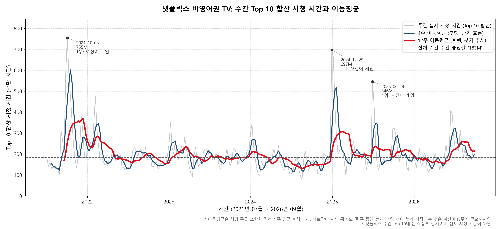

주간 시청 시간의 중앙값은 183.0M시간, 최대는 754.5M시간(2021-10-03)이다. 12주 후행 이동평균은 2022년 이후 130.5M ~ 307.1M시간 범위에서 움직였다. 이동평균은 해당 주와 그 이전 구간만으로 계산했다(중심 이동평균이 아님).

### 그림 2. 전주 대비(WoW) 증감률
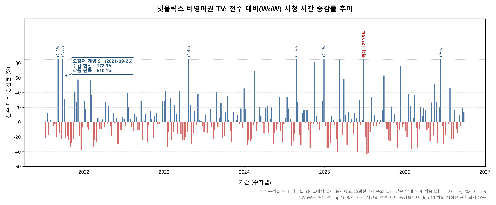

y축 상한을 +85%로 두었고, 이를 넘는 7주는 막대가 잘리며 실제 값을 표시했다. 최대는 2025-06-29의 +239.5%다. 상한을 넘은 7주와 그 주의 1위 작품은 다음과 같다.

| 주 | WoW | 1위 작품 |
|---|---|---|
| 2021-09-05 | +213% | 종이의 집 (Money Heist) |
| 2021-09-26 | +178% | 오징어 게임 (Squid Game) |
| 2023-04-23 | +106% | 더 마크드 하트 (The Marked Heart) |
| 2024-08-25 | +114% | 디 액시던트 (The Accident) |
| 2024-12-29 | +211% | 오징어 게임 (Squid Game) |
| 2025-06-29 | +239% | 오징어 게임 (Squid Game) |
| 2026-06-14 | +93% | 참교육 (Teach You a Lesson) |

2021-09-26 주의 합산 증가율은 +178.3%였고, 같은 주 오징어 게임 단독 증가율은 +610.1%였다. 합계의 증가율은 작품 하나의 증가율보다 작게 나타나므로, 합계의 WoW는 소수 대형 신작의 등장 여부에 크게 좌우된다.

### 그림 3. 작품 수명 그룹별 시청 규모
수명은 작품이 Top 10에 머문 주 수이고, 구간 기준(4주 이하, 5~7주, 8주 이상)은 분석을 위해 정한 것이라 기준을 바꾸면 비율이 달라진다.

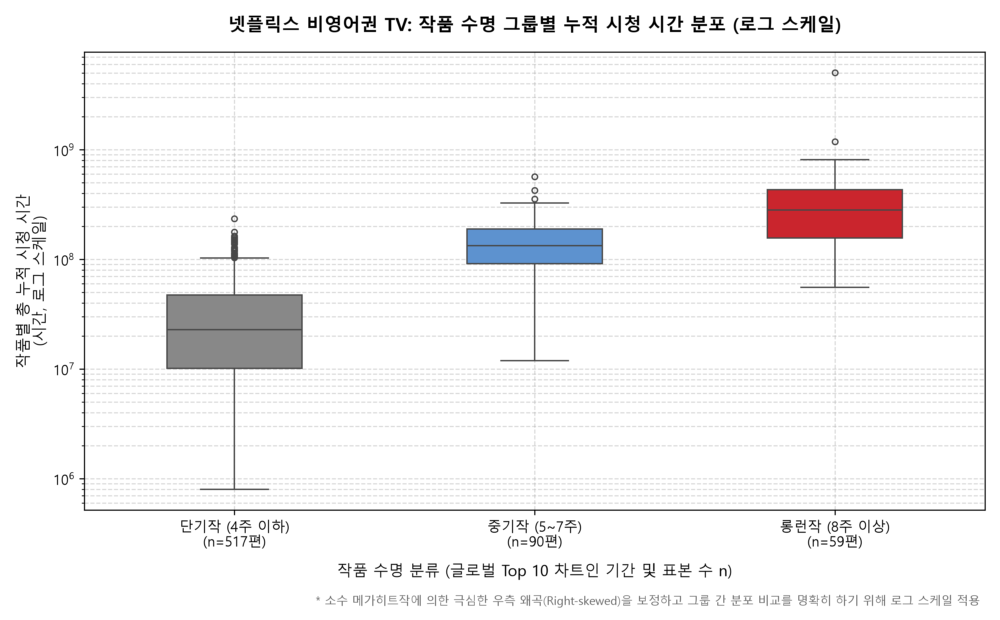

| 그룹 | 작품 수 | 비중 | 전체 시청 점유 | 누적 시청 중앙값 | 최고 주간 시청 중앙값 |
|---|---|---|---|---|---|
| 단기작 (4주 이하) | 517편 | 77.6% | 32.9% | 22.8M | 13.2M |
| 중기작 (5~7주) | 90편 | 13.5% | 24.4% | 133.7M | 39.5M |
| 롱런작 (8주 이상) | 59편 | 8.9% | 42.7% | 282.3M | 44.0M |

제목 기준 상위 20% 작품이 전체 시청의 67.5%, 상위 10편이 20.8%를 차지했다. 누적 시청은 오래 머문 작품일수록 커지는 구조이므로, (B) 패널에서 최고 주간 시청(정점의 세기)을 따로 비교했다. 최고 주간 시청 중앙값은 단기작 13.2M, 중기작 39.5M, 롱런작 44.0M으로, 단기작은 정점 자체가 작았고 중기작과 롱런작의 정점은 비슷했다.

### 그림 4. 최고점 이후 감쇄 곡선
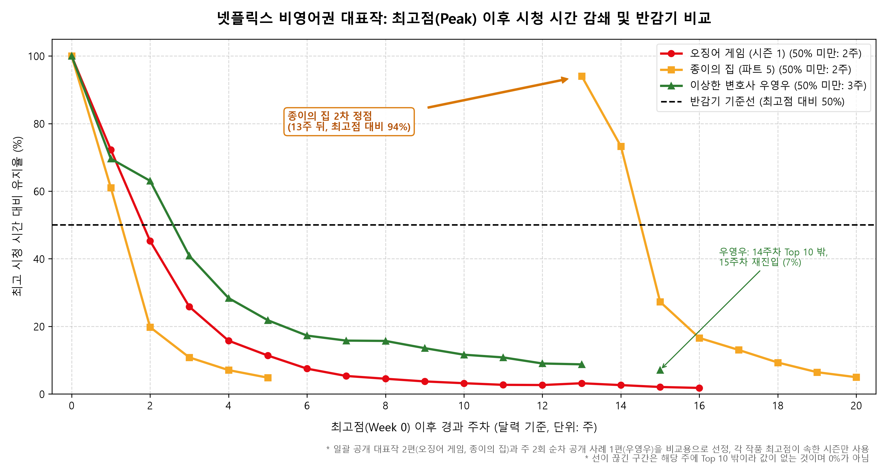

아래 세 작품은 공개 방식이 서로 다른 사례를 비교하려고 고른 것이며, 각 공개 방식 전체를 대표하지 않는다.

| 작품 (시즌) | 공개 방식 | 최고 주간 시청 | 최고점 대비 1주 뒤 | 50% 미만이 처음 된 주 | 최고점에 도달한 시점 |
|---|---|---|---|---|---|
| 오징어 게임 (시즌 1) | 일괄 공개 | 571.8M | 72.2% | 2주 뒤 (45.3%) | 첫 차트 주 + 2주 |
| 종이의 집 (파트 5) | 분할 공개 | 201.9M | 61.0% | 2주 뒤 (19.8%) | 첫 주 |
| 이상한 변호사 우영우 (시즌 1) | 주 2회 순차 공개 | 77.4M | 69.6% | 3주 뒤 (40.9%) | 첫 차트 주 + 6주 |

종이의 집은 최고점 뒤 6주째부터 12주째까지 7주 동안 Top 10 밖에 있었고(선이 끊긴 구간), 13주 뒤에 최고점의 94.1%(189.9M)로 다시 올랐다. 우영우는 최고점 이전에 31 → 59 → 71 → 85 → 87 → 90 → 100%로 점진적으로 올랐다.

### 그림 5. 연도별 주간 평균과 중앙값
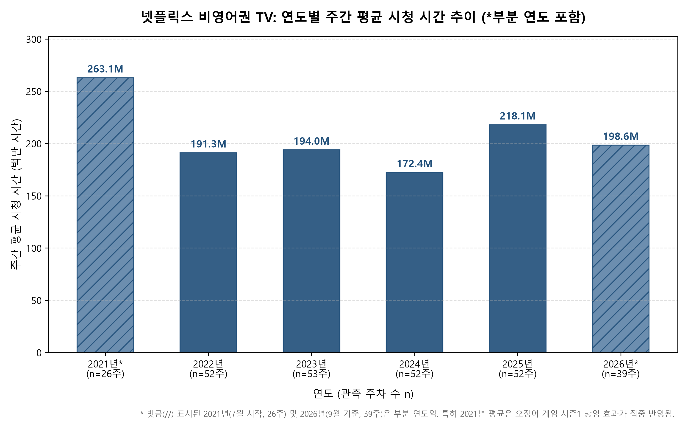

| 연도 | 주 수 | 평균(M) | 중앙값(M) | 최대(M) | 평균/중앙값 |
|---|---|---|---|---|---|
| 2021* | 26 | 263.1 | 190.2 | 754.5 | 1.38 |
| 2022 | 52 | 191.3 | 181.7 | 478.0 | 1.05 |
| 2023 | 53 | 194.0 | 189.6 | 350.0 | 1.02 |
| 2024 | 52 | 172.4 | 166.2 | 697.0 | 1.04 |
| 2025 | 52 | 218.1 | 197.2 | 661.2 | 1.11 |
| 2026* | 39 | 198.6 | 188.7 | 409.3 | 1.05 |

\* 부분 연도: 2021년은 7월부터 12월까지 26주, 2026년은 1월부터 9월까지 39주다. 완전 연도 4개의 중앙값은 166.2M ~ 197.2M 범위이며, 가장 낮은 해는 2024년(166.2M), 가장 높은 해는 2025년(197.2M)이다.

### 그림 6. 시청 상위 40개 작품의 언어권 구성
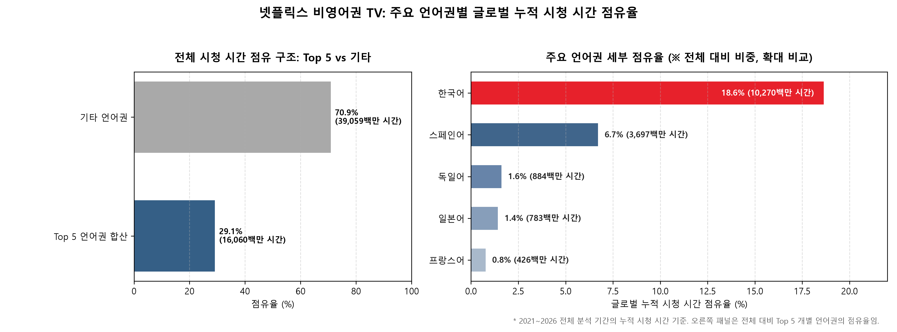

시청 시간 상위 40개 작품(전체 Top 10 시청 시간의 40.6%)을 제목으로 직접 분류했다. 작품마다 제작 국가와 원어를 검색해 확인했고, 남아공 드라마 「아내가 여럿인 남자 (The Polygamist)」(줄루어 중심)는 '기타(줄루어)', 멕시코 드라마 「대리모 (The Surrogacy)」는 스페인어로 두었다.

| 언어 | 작품 수 | 상위 40개 내 시청 비중 |
|---|---|---|
| 한국어 | 23편 | 64.1% |
| 스페인어 | 13편 | 29.1% |
| 일본어 | 1편 | 2.5% |
| 프랑스어 | 1편 | 1.8% |
| 독일어 | 1편 | 1.3% |
| 기타(줄루어) | 1편 | 1.2% |

연도별 한국어 비중은 2021년 59%, 2022년 49%, 2023년 46%, 2024년 72%, 2025년 89%, 2026년 82%다. 이 값은 그림 6과 같은 상위 40개 작품을 대상으로, 연도마다 그 해 시청 시간을 언어별로 합산해 나눈 비중이며 전체 점유율이 아니다. 이 흐름의 해석은 인사이트 4에서 다룬다.

### 그림 7. STL 분해와 12주 기준선 예측
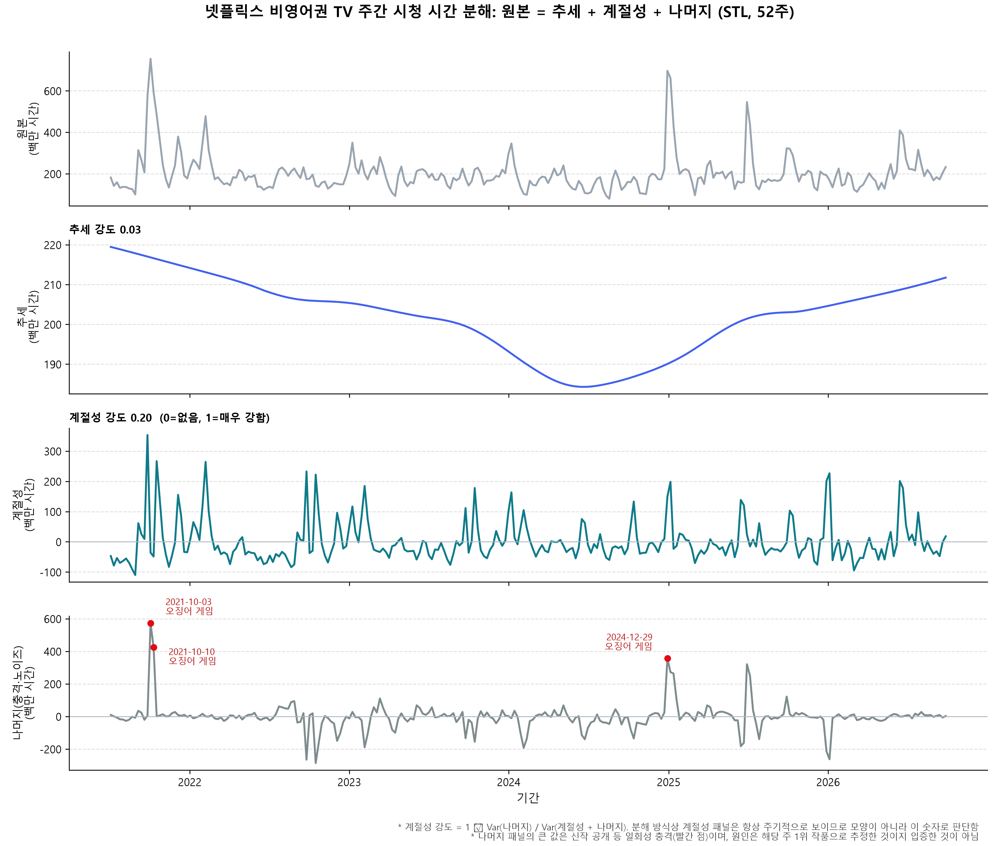
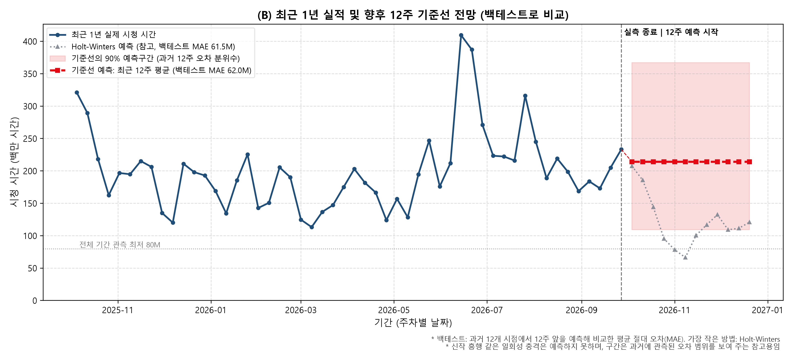

- 추세 강도 0.03. 계절성 강도는 원본 0.20, 상위 5%를 상한 처리하면 0.38로 처리 방식에 따라 달랐다.
- 잔차 상위 3주는 2021-10-03(+573.3M), 2021-10-10(+424.1M), 2024-12-29(+356.8M)이고, 모두 그 주 1위 작품이 오징어 게임이었다.
- 롤링 백테스트(12개 시점 × 12주 예측)의 MAE(단위: 백만 시간): 최근 12주 평균 62.0M, 작년 같은 주 값 72.7M, Holt-Winters 62.3M. MAE가 가장 낮은 것은 가장 단순한 방법인 최근 12주 평균이었다.
- 기준선 예측은 214.0M, 90% 구간은 109.1M ~ 366.8M(과거 오차의 5~95% 분위수)이다. 구간이 넓어 참고용으로만 본다.

## 5. 인사이트

### 인사이트 1. 기본 수요는 크게 변하지 않았고, 큰 변동은 소수 대형 신작이 만들었다

- **관찰(Fact)**
  - 완전 연도 4개(2022~2025)의 주간 중앙값은 166.2M ~ 197.2M 범위에서 움직였고, 뚜렷한 상승이나 하락 추세는 없다. STL 추세 강도도 0.03이다.
  - WoW가 +85%를 넘은 7주는 5개 작품(종이의 집, 오징어 게임, 더 마크드 하트, 디 액시던트, 참교육)에서 나왔고, 그중 오징어 게임이 3주다. STL 잔차 상위 3주는 모두 오징어 게임이다.
- **이유(해석, 가설)** 주간 합계의 큰 오르내림은 플랫폼 전체 수요의 변화보다 소수 대형 신작의 공개 시점이 만든 것으로 보인다. 다만 오징어 게임 한 작품에 모든 변동을 돌릴 수는 없다. 다른 작품도 상한을 넘는 주를 만들었다.
- **행동(Action, 제안)** 비영어권 시장의 기초 체력을 볼 때 평균이나 합계 증가율만 보지 않고 **중앙값**을 함께 본다. 1위 작품을 뺀 2~10위 합계도 보조 지표로 만들어 비교해 볼 수 있다(이 분석에서는 아직 계산하지 않았다).
- **반례와 한계** 달력 연도로 나누면 연말·연초에 걸친 히트가 두 해로 쪼개진다. 2024년 최대 주간(697.0M)은 12월 말이고 그 후속 주는 2025년에 들어가므로, 연도 평균은 이런 히트의 영향을 한쪽 해에만 반영한다. 또 2021년은 부분 연도(26주)다.

### 인사이트 2. 작품의 수명은 한쪽으로 쏠려 있고, 누적 시청의 차이는 정점이 아니라 체류 기간에서 나온다

- **관찰(Fact)**
  - 4주 이하로 사라진 작품이 77.6%(517편)이지만 전체 시청의 32.9%만 차지한다. 반대로 8주 이상 머문 작품은 8.9%(59편)인데 42.7%를 차지한다. 상위 20% 작품이 전체 시청의 67.5%다.
  - 롱런작과 중기작은 최고 주간 시청 중앙값이 44.0M 대 39.5M로 비슷한데, 누적 시청 중앙값은 282.3M 대 133.7M으로 2배 넘게 차이 난다.
- **이유(해석, 가설)** 롱런작이 더 크게 터져서가 아니라 더 오래 Top 10에 머물러서 누적이 커진 것으로 보인다. 단기작은 정점 자체가 작다(중앙값 13.2M).
- **행동(Action, 제안)** 신작을 평가할 때 첫 주 시청량만이 아니라 **몇 주 동안 Top 10에 머무는지**를 함께 본다. 그 기준을 어디에 둘지는 이 데이터만으로는 정할 수 없고, 추가 분석이 필요하다.
- **한계** 누적 시청은 체류 기간이 길수록 커지는 구조적 관계라서 "롱런작이 더 인기 있다"는 근거가 아니다. 분포 형태의 정확한 적합(멱법칙 등)은 이 분석의 범위를 벗어나 하지 않았고, "소수 작품에 시청이 집중된다"는 수준으로만 해석한다.

### 인사이트 3. 최고점 이후의 감쇄 속도는 세 사례에서 비슷했고, 분할 공개 사례만 두 번째 정점이 있었다

- **관찰(Fact)** 세 작품 모두 최고점 1주 뒤 61%에서 72%였고, 50% 아래로 내려간 것은 2주에서 3주 뒤였다. 종이의 집 파트 5는 최고점 뒤 7주 동안 Top 10 밖에 있다가 13주 뒤 최고점의 94.1%로 다시 올랐다. 우영우는 첫 차트 주 31%에서 6주에 걸쳐 최고점에 올랐다.
- **이유(해석, 가설)** 종이의 집의 두 번째 정점은 파트 5 후반부 공개 시점과 맞물린 것으로 보이나, 공개 일정을 별도로 확인하지 않았으므로 가설 수준으로만 제시한다. 우영우의 점진적인 상승은 주 2회 순차 공개 방식과 연결해 볼 수 있다.
- **행동(Action, 제안)** 분할 공개와 순차 공개 작품을 더 많이 모아 감쇄 곡선을 비교해 본다. 구독 유지(리텐션)나 해지에 어떤 영향을 주는지는 가입자 데이터가 있어야 검증할 수 있다.
- **한계** 사례는 3개뿐이라 공개 방식 전체로 일반화할 수 없다. 분할 공개가 구독 유지를 높였다고 말할 수 있는 근거는 없다.

### 인사이트 4. 한국어 비중 상승에는 오징어 게임의 시청 증가와 스페인어 작품의 감소가 함께 작용했다

- **관찰(Fact)** 상위 40개 작품 중 한국어가 23편, 시청 비중 64.1%다. 연도별 한국어 비중은 2023년 46%에서 2024년 72%, 2025년 89%로 올랐고, 오징어 게임을 뺀 값도 46% → 65% → 77%로 같은 방향이다. 그런데 분류된 40편의 주당 평균 시청 시간(백만 시간)을 보면 한국어는 33.9(2023) → 42.9(2024) → 70.5(2025)이고, 스페인어는 29.3 → 14.4 → 5.0으로 줄었다. 오징어 게임을 뺀 한국어는 2023년 33.4, 2024년 32.0, 2025년 28.9로 늘지 않았다(2025년 한국어 70.5 중 오징어 게임이 41.6, 상위 40편 시청의 53%). 다만 부분 연도인 2026년(1~9월)에는 오징어 게임 없이 한국어가 45.8로 다시 올랐다.

| 연도 | 한국어 | 스페인어 | 일본어 | 프랑스어 | 독일어 | 기타(줄루어) |
|---|---|---|---|---|---|---|
| 2021* | 97.2 | 63.1 | 3.2 | 1.9 | 0.0 | 0.0 |
| 2022 | 45.2 | 42.1 | 1.5 | 0.0 | 3.1 | 0.0 |
| 2023 | 33.9 | 29.3 | 3.9 | 6.7 | 0.0 | 0.0 |
| 2024 | 42.9 | 14.4 | 0.0 | 0.0 | 2.6 | 0.0 |
| 2025 | 70.5 | 5.0 | 3.6 | 0.0 | 0.0 | 0.0 |
| 2026* | 45.8 | 3.3 | 0.0 | 0.0 | 0.0 | 6.8 |

(분류된 40편의 주당 평균 시청 시간, 백만 시간. Top 10 밖인 주는 0으로 계산. *는 부분 연도)

- **이유(해석, 가설)** 비중이 오른 데에는 두 힘이 같이 작용한 것으로 보인다. 하나는 2025년 오징어 게임의 시청이고(한국어 증가분의 상당 부분), 다른 하나는 스페인어 작품이 상위권에서 빠진 것이다. 따라서 2023~2025년의 상승을 "한국어 콘텐츠 전반의 시청 증가"로 단정하기는 어렵다. 2026년의 반등이 이어지는지는 연도가 끝나야 확인할 수 있다. 스페인어 작품이 줄어든 원인(신작 부족, 종이의 집 종영 등)은 이 데이터로 확인하지 못했다.
- **행동(Action, 제안)** 비중이 아니라 주당 평균 시청 시간 같은 절대량으로 보고, 오징어 게임을 뺀 한국어 작품의 시청이 어떻게 변했는지를 따로 추적한다. 언어 분류를 상위 40개 밖으로 넓힌 뒤 같은 비교를 해 보는 것이 선행 과제다.
- **반례와 한계** 2021년의 한국어 59%는 오징어 게임이 52%를 차지했고, 뺀 값은 14%다. 오징어 게임을 뺀 값은 오징어 게임 시청 시간을 따로 합산해 계산했다. 상위 40개는 전체 기간 누적 기준으로 뽑았고 전체 Top 10 시청의 40.6%만 다룬다. 오징어 게임은 시즌 1~3이 한 작품으로 합쳐져 있다. 언어는 제목을 보고 직접 분류한 추정치다.

## 6. 결론, 한계, 다음에 필요한 데이터

### 결론
1. 비영어권 TV의 주간 시청 중앙값은 완전 연도 기준 166~197M 범위에서 움직였으며, 뚜렷한 성장이나 하락 추세는 관찰되지 않았다. 큰 변동은 소수 대형 신작의 공개 주에 몰려 있다.
2. 시청 시간은 소수 롱런작에 집중돼 있다. 8주 이상 머문 작품이 9%인데 전체 시청의 43%를 차지한다. 누적 시청 차이는 정점의 세기보다 체류 기간에서 나온다.
3. 최고점 이후의 감쇄 속도는 세 사례에서 비슷했고, 공개 방식에 따른 차이는 정점에 도달하는 경로와 재상승 여부에서 나타났으나, 3개 사례라서 공개 방식과의 인과관계는 확인하지 못했다.
4. 상위 작품은 한국어 작품이 가장 많고 비중도 높아졌지만, 오징어 게임을 뺀 한국어의 절대 시청은 2023~2025년에 늘지 않았다. 비중 상승에는 스페인어 작품의 감소도 함께 작용한 것으로 보인다.

### 한계
- **Top 10만 관측**: 순위 밖에서 소비되는 시청은 볼 수 없다. 모든 결과는 "Top 10에 든 작품의 합" 기준이다.
- **작은 표본의 사례 분석**: 감쇄 비교는 3개 작품이다. 공개 방식(일괄, 분할, 순차)이 서로 다른 대표 사례로 골랐지만, 공개 방식과의 인과관계를 말할 수 없다. 더 많은 사례로 넓히는 것이 다음 과제다.
- **언어 분류의 범위**: 데이터에 언어 컬럼이 없어 상위 40개(전체의 40.6%)를 직접 분류했다. 나머지 626개 작품(전체의 59.4%)은 분류하지 않았다. 한국어 64.1%는 분류된 40개 안에서의 비중이며, 전체 시청 시간 기준으로는 약 26%다.
- **계절성**: 5년(약 5주기) 데이터로는 52주 계절성을 안정적으로 추정하기 어렵다. 계절성 강도가 0.20에서 0.38까지 처리에 따라 달랐고, 연도별 주차 패턴의 상관은 0.10에서 0.40까지였다. 뚜렷한 연간 계절성은 확인하지 못했다.
- **외부 변수 미통제**: 공휴일, 경쟁 서비스의 대형 출시, 공개 요일 등은 반영하지 않았다.
- **러닝타임 보정 없음**: 시청 시간은 러닝타임이 긴 작품에 유리하다. 시청 횟수(`weekly_views`)와 러닝타임(`runtime`) 컬럼은 2023-06-18 주부터만 값이 있어(앞 102주는 모두 비어 있음) 전 기간을 같은 기준으로 비교할 수 없어 쓰지 않았다. 2023-06-18 이후로 구간을 좁혀 시청 횟수 기준으로 다시 보는 것이 다음 과제다.

### 다음에 필요한 데이터
우선순위 순서다.
1. **최우선, 작품별 공개 일정과 방식(일괄, 분할, 순차) 메타데이터**: 인사이트 3의 공개 방식 비교를 검증하는 데 직접 필요하다. 공개된 작품 정보나 보도 자료에서 모을 수 있다.
2. **최우선, 작품별 언어와 제작 국가 메타데이터**: 직접 분류한 40편을 전체 작품으로 넓히기 위해 필요하다. 공개 작품 정보 페이지나 영화·드라마 데이터베이스에서 모을 수 있다.
3. **차선, 러닝타임과 시청 횟수(views)**: 길이를 보정한 비교를 위해 필요하다. 이미 데이터에 있지만 2023-06-18 주부터만 값이 있다.
4. **차선, Top 10 밖의 시청 데이터**: 카탈로그 전체의 기본 수요를 보기 위해 필요하다. 넷플릭스 내부 데이터라 외부에서 얻기 어렵다.
5. **장기, 가입자 수와 이탈(해지) 데이터**: 분할 공개와 구독 유지의 관계를 검증하기 위해 필요하다. 외부 확보가 어렵다.

## 7. 보너스 과제

### 7-1. 시계열 분해와 예측
STL(52주 주기, 이상치에 강한 `robust=True`)로 원본을 추세, 계절성, 나머지로 분해하고(그림 7), 12주 앞을 예측하는 롤링 백테스트로 세 방법의 오차(MAE)를 비교했다. 가장 단순한 방법(최근 12주 평균)이 가장 정확했고, Holt-Winters는 비슷했으며, 작년 같은 주 값은 더 나빴다. 이는 연간 반복 패턴이 약하다는 점과 일치한다. 또한 Holt-Winters의 예측 최저값(65.7M)이 관측 최저(79.5M)보다 낮아 보수적인 해석이 필요하므로 예측 설명에는 기준선만 사용한다.

### 7-2. 인터랙티브 대시보드 (Streamlit)
전처리된 CSV를 읽어 필터(기간, 언어권, 작품)에 따라 결과가 바뀌는 대시보드다. 실행: `python -m streamlit run app.py`.

**필터를 바꾸면 결과가 달라지는 장면**

| 조작 | 화면에서 보이는 것 |
|---|---|
| 언어권 '한국어' 선택 | 분류된 한국어 작품만의 주간 합계에서 약 600M 시간의 두 봉우리(2021년 10월, 2025년 1월)와 20~100M 시간 수준의 평소 구간이 구분된다. |
| 작품 'Squid Game'만 선택 | Top 10에 있던 세 구간(2021년 말, 2024년 말~2025년 초, 2025년 중반)에서만 선이 나타나고 나머지 주는 값이 없어 선이 끊긴다. |
| 기간 2024-01-01 ~ 2025-12-31 | 연도별 주간 평균이 2024년 172.4M, 2025년 218.1M 시간이고 두 해 모두 중앙값이 평균보다 낮다. |
| '비중 기준' 전환 | 같은 한국어가 분류된 작품 안에서는 64.1%, 전체 시청 시간 기준으로는 26.0%로 나타난다. 분모가 다르기 때문이다. |

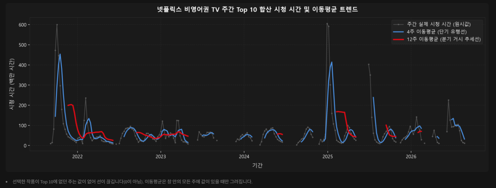
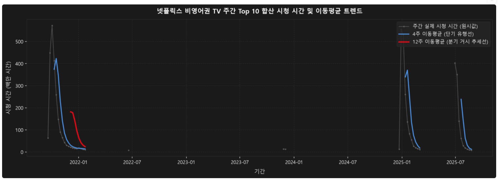
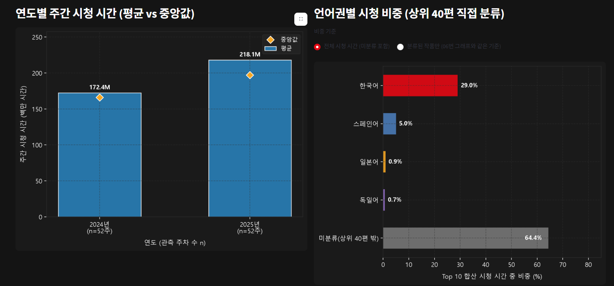
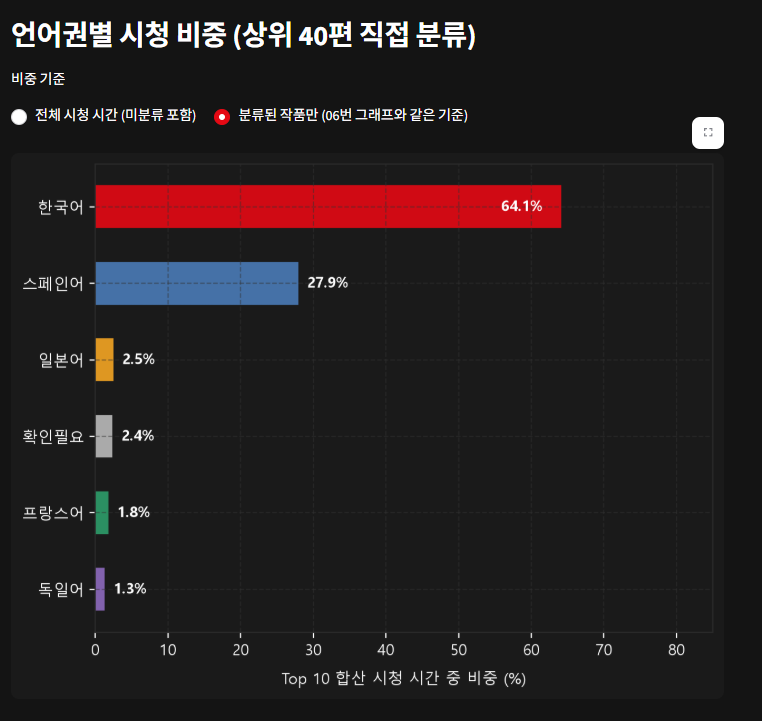
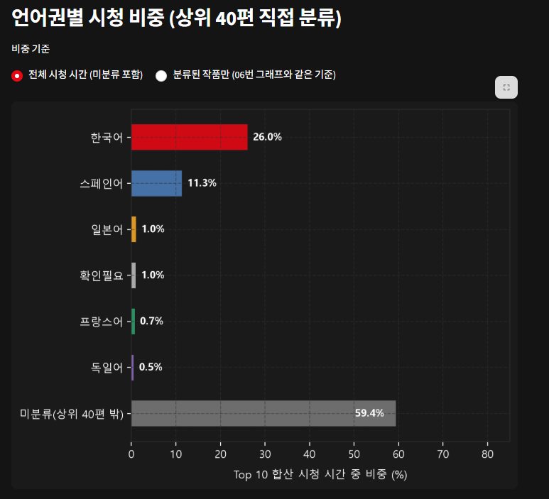
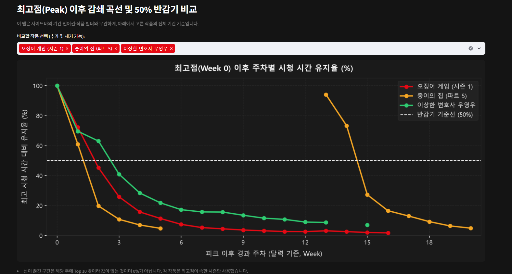

위 시나리오로 확인하려던 것:
- 한 작품(예: 오징어 게임)이 주간 합계를 얼마나 좌우하는가
- 언어권별 시청 흐름이 어떻게 다른가
- 기간을 바꾸면 결론이 달라지는가

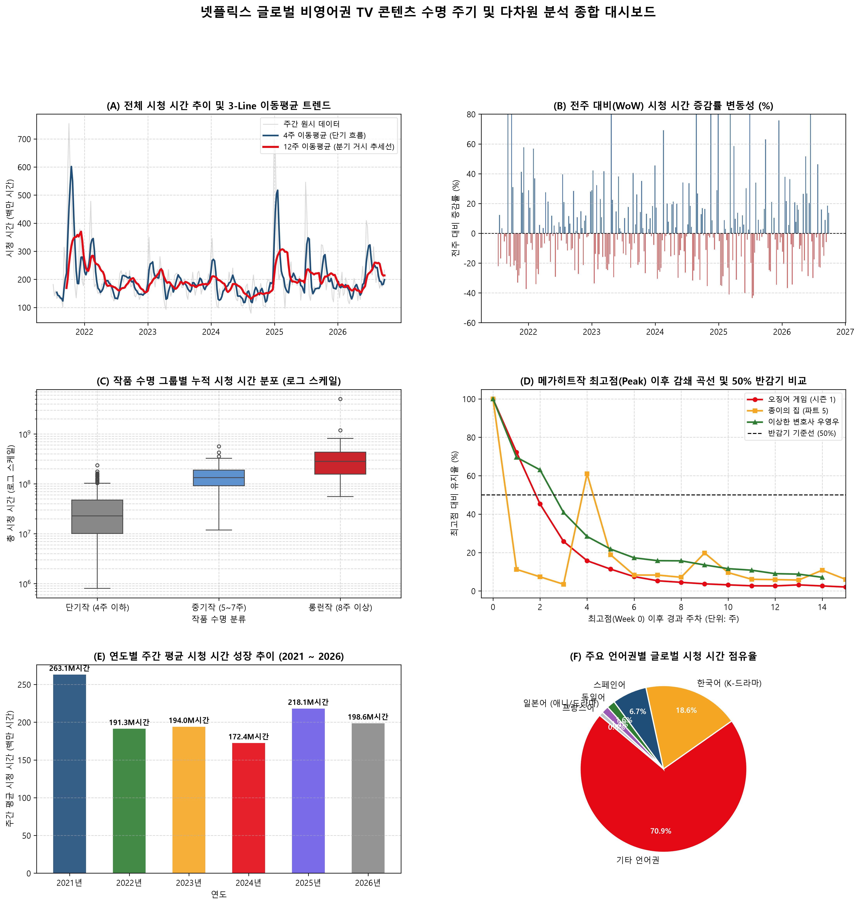

## 8. AI 사용 로그

| 구분 | 내용 |
|---|---|
| 사용한 도구 | Claude (분석 코드, 보고서 작성과 검증 전반), ChatGPT와 다른 Claude 대화 (README·보고서 검토 의견 참고) |
| 사용한 작업 | 데이터 정제와 점검 코드 작성, 시계열 기법 비교, 그래프 코드 작성과 수정, 대시보드(Streamlit) 코드 작성, 보고서 구조화 |
| 사용한 이유 | 반복적인 코드 작성 시간을 줄이고, 여러 시각화 후보를 빠르게 비교하기 위해 |

### AI 결과를 어떻게 검증했는가
AI가 제시한 수치와 해석을 그대로 쓰지 않고, 원본 데이터로 직접 다시 계산해 비교했다.

| # | AI가 제시한 내용 | 직접 확인한 값 | 조치 |
|---|---|---|---|
| ① | 종이의 집 2차 정점: "4주 뒤 61%" | 13주 뒤 94.1% (달력 기준 경과 주차로 재계산, Top 10 밖 7주) | 그림 4와 인사이트 3에 정정 반영 |
| ② | WoW 최대 "+240.2%" | 역대 최대 +239.5%(2025-06-29), 2021-09-26 합산 +178.3%, 오징어 게임 단독 +610.1% | 그림 2 주석 정정 |
| ③ | 대시보드 문구의 최고 주간 시청 "5.7억" | 754.5M(2021-10-03). 오징어 게임 시즌 1 단독 571.8M | 문구를 계산값으로 대체 |
| ④ | 수명 그룹 비율 67 / 19 / 14% | 77.6 / 13.5 / 8.9% (517 / 90 / 59편) | 그림 3, 인사이트 2 정정 |
| ⑤ | 12주 이동평균 범위 "1.8~2.2억" | 2022년 이후 130.5M ~ 307.1M | 그림 1 설명 정정 |
| ⑥ | 언어 비중 "한국어 18.6%, 기타 70.9%" (키워드 분류) | 미분류 상위 12개 중 8개가 한국어 작품이었고, `dark` 키워드는 Dark Desire 등 5개를 독일어로 잘못 분류 | 키워드 분류를 버리고 상위 40개 직접 분류로 교체, 범위를 명시 |
| ⑦ | 계절성 "연말 +15~20%" | STL 계절성 강도가 처리 방식에 따라 0.20 ~ 0.38, 연도별 주차 패턴 상관 0.10 ~ 0.40, 작년 값 예측이 단순 평균보다 나쁨 | 계절성을 주장하지 않기로 함 |
| ⑧ | 분해 후 합이 원본과 같다는 "검산" | 잔차를 "원본 − 추세 − 계절성"으로 정의하면 합이 원본과 같은 것은 수식상 당연해서 모델이 맞는지 검증하는 방법이 될 수 없음 | 검증 방법에서 제외, 백테스트 MAE 비교로 대체 |
| ⑨ | AI가 붙인 상위 40개 작품의 언어 라벨 | 확신이 낮았던 5편의 제작 국가와 원어를 기사로 확인. 남아공 드라마 아내가 여럿인 남자 (The Polygamist, 줄루어 중심), 멕시코 드라마 대리모 (The Surrogacy, 스페인어, 원제 Madre de alquiler), 한국 드라마 참교육 (Teach You a Lesson, 웹툰 원작), 김부장 (Agent Kim Reactivated, 소지섭 주연), 키스는 괜히 해서! (Dynamite Kiss, 로코) | 확인 전 "미확인"이던 2편을 '기타(줄루어)'와 스페인어로 분류 |
| ⑩ | 앱의 한국어 비중이 그림 6의 64.1%와 같다는 설명 | 그림 6은 상위 40편 안의 비중(분모=40편 합계), 앱은 미분류를 포함한 전체가 분모여서 약 26.0%(64.1% × 40.6%) | 앱에 비중 기준 선택을 추가하고, REPORT에 두 기준을 함께 적음 |

**코드로 한 검증**

| 확인한 것 | 방법 | 결과 |
|---|---|---|
| WoW 증감률 | 02번 코드에서 CSV 값과 원본 재계산, 두 방식 비교 | 최대 차이 0.0000%p |
| 수명 그룹 비율 | 코드로 작품 수를 세어 대조 | 517 / 90 / 59편 일치 |

**내가 직접 한 확인**

| 확인한 것 | 방법 | 알게 된 것 |
|---|---|---|
| 작품 언어 라벨 | 확신이 낮은 작품을 직접 검색 | 5편의 제작 국가와 원어를 확인하고 라벨 정정 |
| 한국어 비중 26.0% vs 64.1% | 왜 다른지 AI에게 되물음 | 분모가 다름(전체 시청 시간 vs 분류된 40편) |
| 그림과 대시보드 화면 | 직접 보고 이상한 부분 지적 | 글자 안 보임, 선 연결 오류 등을 고침 |
| 노트북 결과 | 01~04번을 처음부터 다시 실행 | 가공 데이터가 이전과 같음 |

### 판단의 책임

**내가 직접 결정한 것**

| 결정 | 근거 |
|---|---|
| 원본 TSV(`all-weeks-global.tsv`)를 저장소에 올리지 않음 | 넷플릭스 이용 약관 1.8조가 서비스에서 얻은 정보의 복제·배포를 제한함. 재배포 가능 여부가 불분명해서 안전한 쪽을 택하고, README에 직접 내려받는 방법을 적음 |
| 앱의 한국어 비중을 두 기준으로 나눠 보여 줌 | 앱의 26.0%와 그림 6의 64.1%가 달라 보여서 직접 짚었고, 분모가 다르다는 것을 확인한 뒤 "비중 기준" 선택 버튼을 넣기로 함 |
| 작품명을 한국어 공식 제목으로 표기 | 영어 제목만으로는 읽기 어려워서 공식 한국어 제목을 직접 찾아 알려 주고 적용함 |
| 데이터의 시작 시점을 서비스 역사와 구분해 README에 적음 | 넷플릭스는 1997년에 시작했고 2016년에 190여 개국으로 확대했지만, 이 분석 데이터는 2021년 7월부터라는 점을 직접 문장으로 정리함 |

**AI의 도움을 받은 부분**

| 부분 | AI가 한 일 | 내가 한 일 |
|---|---|---|
| 정제·시계열 코드, 그래프, 대시보드 | 코드 작성과 수정 | 화면을 보고 잘못된 곳을 지적하고, 노트북을 다시 실행해 결과 확인 |
| 인사이트와 한계 서술 | 초안 작성 | 숫자를 원본 데이터로 다시 확인하고, 틀린 값(위 검증 표 ①~⑩)은 정정 |
| 작품 언어 분류 | 라벨 초안 | 확신이 낮은 작품을 직접 검색해 확인 |
| 그래프·수치 교차 검증 | 원본 데이터로 다시 계산해 AI의 이전 수치와 비교(검증 표 ①~⑩) | 결과를 읽고 맞는지 판단, 화면에서 이상한 부분을 지적, 정정이 반영됐는지 확인 |

AI가 만든 숫자는 원본 데이터로 다시 확인한 후 보고서에 작성되었다.

## 9. 실행 방법
- 원본 데이터(`all-weeks-global.tsv`)는 저장소에 없으므로 `data/raw/`에 직접 내려받아 넣는다.
- 패키지는 `requirements.txt`로 설치한다.
- 노트북은 `notebooks/`의 01번부터 04번까지 순서대로 실행한다.
- 대시보드는 `python -m streamlit run app.py`로 실행한다.
- 자세한 순서는 `README.md`의 「실행 방법」을 참고한다.